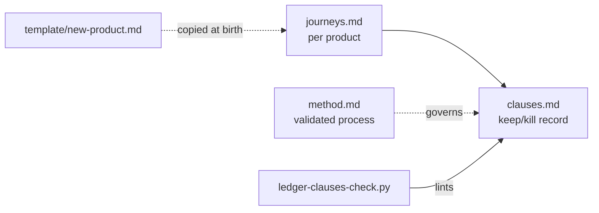

# product-ui-docs — docs guide

> **This is a living document.** It is this repo's chapter in the
> Fleet Book (warp#6279): the newcomer onboarding plus a reference
> pointer into the rest of the docs. Distinct from the README (the
> router — where to go). Refresh it whenever the shape of product-ui-docs
> changes enough that a newcomer's mental model would be wrong.

## Onboarding — start here

This repo is the **product-UI ledger** for Gyrum surfaces: the recorded
argument for which screens exist and why. Canon owns the design-system
vocabulary; this repo owns the per-product decisions — journeys, screen
inventory, and a clause ledger where every keep/kill decision carries an
enforced lifecycle (`captured → drafted → landed`).

The one thing to understand before anything else: **a clause is not done
until it points at evidence** — for `landed`, a merged PR URL. A proposal
without evidence is opinion, and this repo's whole job is to keep opinion
from masquerading as shipped product.

Prove your checkout works:

```bash
bash scripts/ledger-clauses-check.sh
```

To make a trivial change (e.g. flip a clause state after its PR merges):
edit `docs/products/<product>/clauses.md`, run the check above, then go
through the normal branch → review → merge flow.

## How it fits together

No component diagram: this repo is documentation plus one lint script.
The moving parts are the documents and their relationships:



- `docs/method.md` — the journey-first process, validated by the real
  ops.gyrum.ai reduction.
- `docs/products/<product>/journeys.md` — what operators do, weighted,
  with evidence sources and admitted gaps.
- `docs/products/<product>/clauses.md` — every surface decision as a
  clause; PRs cite clauses; landing requires merged-PR evidence.
- `docs/template/new-product.md` — copy at birth for new products.

## How we got here

| When       | What changed                                                          | Why / reference                   |
| ---------- | --------------------------------------------------------------------- | --------------------------------- |
| 2026-08-21 | ops.gyrum.ai reduction EPIC raised (journey-first, not crawl-and-fix) | warp#14685                        |
| 2026-08-22 | Journeys + IA contract landed in ai-frontend                          | ai-frontend PR #1197 / warp#14686 |
| 2026-08-22 | Reduced rail shipped (6 sections/22 seats, dupes killed)              | ai-frontend PR #1200 / warp#14687 |
| 2026-08-22 | This repo created + seeded: method, journeys, 12-clause ledger        | warp#14690                        |

## Reference — where to find everything

| I need to…                                        | Go to                                                                       |
| ------------------------------------------------- | --------------------------------------------------------------------------- |
| understand what this repo is                      | [README.md](../README.md)                                                   |
| run the validated reduction process               | [docs/method.md](method.md)                                                 |
| see the ops.gyrum.ai journeys                     | [docs/products/ops.gyrum.ai/journeys.md](products/ops.gyrum.ai/journeys.md) |
| read or amend a keep/kill decision                | [docs/products/ops.gyrum.ai/clauses.md](products/ops.gyrum.ai/clauses.md)   |
| start documentation for a NEW product             | [docs/template/new-product.md](template/new-product.md)                     |
| lint the ledgers                                  | `bash scripts/ledger-clauses-check.sh`                                      |
| see the design-system vocabulary this complements | https://canon.gyrum.ai                                                      |
