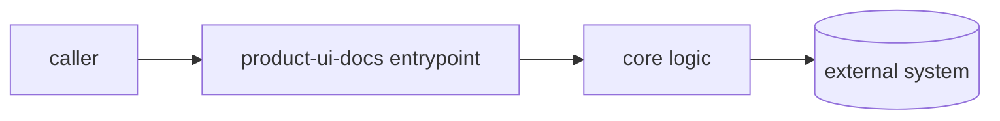

<!-- gyrum-template-do-not-grade -->
<!--
This file was seeded by gyrum-setup from templates/docs-guide.md.tmpl.
Once you replace the prompt text below with real content, DELETE both
of these HTML comments — that re-enables the docs-guide merge-gate
(warp#6302) which refuses merge while this chapter is still the
unfilled stub. Keeping the marker after filling it in would silence
that gate indefinitely; the gate team prefers an explicit operator
action over a stealthy default. The same marker contract governs
userguide.md and the README; see docs/runbooks/docs-guide-gate-fail.md.
-->

# product-ui-docs — docs guide

> **This is a living document.** It is this repo's chapter in the
> Fleet Book (warp#6279): the newcomer onboarding plus a reference
> pointer into the rest of the docs. Distinct from the README (the
> router — where to go) and the userguide (the manual — how to drive
> the product). Refresh it whenever the shape of product-ui-docs
> changes enough that a newcomer's mental model would be wrong.

## Onboarding — start here

_TEMPLATE — replace this prompt with the real content._ Write this
for an engineer (or an agent) who has just been pointed at
product-ui-docs and has thirty minutes. Answer, in order: what is
this repo, what problem does it solve, and what is the one thing you
must understand before any of the code makes sense. End with the
single command that proves the checkout works (build, test, or run).
A reader who finishes this section should be able to make a trivial
change with confidence, not just read about the project.

## How it fits together

_TEMPLATE — replace this prompt with the real content._ Give the
reader a mental model of the moving parts. A **mermaid diagram** is
the cheapest way to do this — sketch the components and the edges
between them so the architecture is legible at a glance rather than
reconstructed from prose:

Replace the placeholder nodes with the real components. If this repo
has no diagram-worthy structure (a single-purpose library, say), say
so explicitly — "no component diagram: this repo is one module" — so
the absence is a decision, not an omission.

## How we got here

_TEMPLATE — replace this prompt with the real content._ A short
**timeline** of the load-bearing decisions, newest last. A newcomer
who reads it should understand why the code looks the way it does
rather than re-litigating settled choices. Link each entry to its
ADR, warp ticket, or PR so the reasoning chain is recoverable:

| When | What changed | Why / reference |
|---|---|---|
| 2026-08-22 | _the founding decision_ | _ADR / warp#NNNN / PR link_ |

Keep this to the handful of decisions that still shape the code
today — it is a timeline, not a changelog.

## Reference — where to find everything

_TEMPLATE — replace this prompt with the real content._ This is the
pointer section: a short index from "I need X" to the document that
covers X. One row per destination; cross-link rather than duplicate.
At minimum point at the README (router), the userguide (manual), the
test docs, and any runbooks. The test of this section is that a
reader never has to grep the tree to find the right document.

| I need to… | Go to |
|---|---|
| understand what this repo is | README.md |
| drive the product | docs/userguide.md |
| run or extend the tests | docs/TESTING.md |
| recover from a known failure | docs/runbooks/ |
